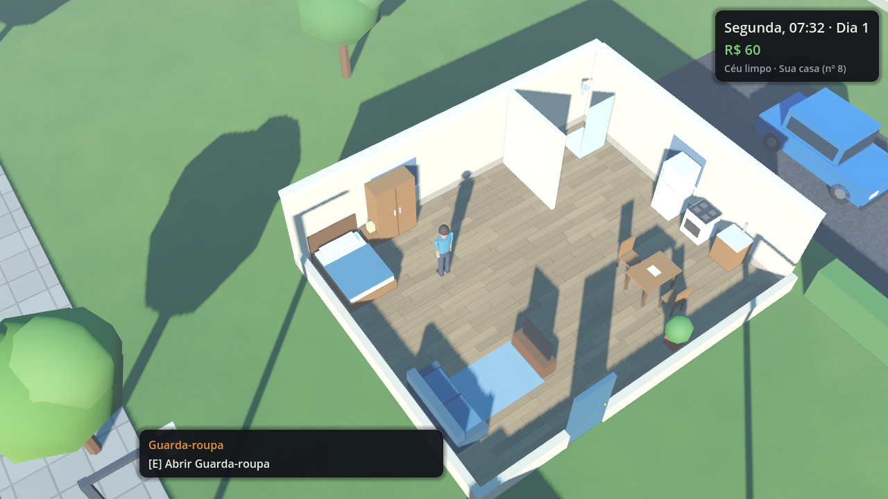
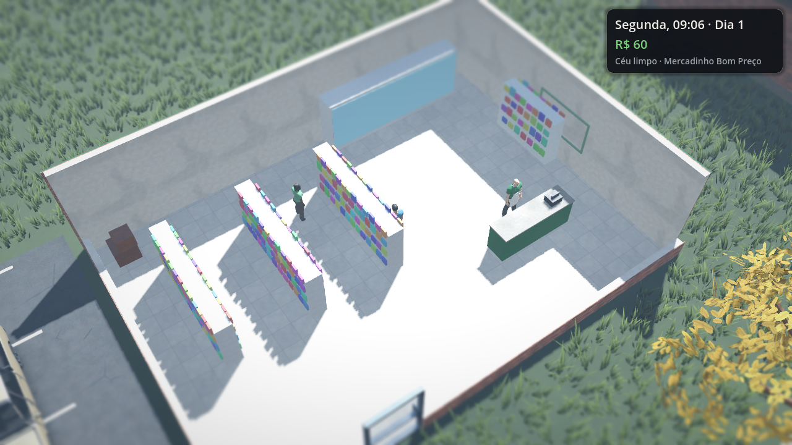
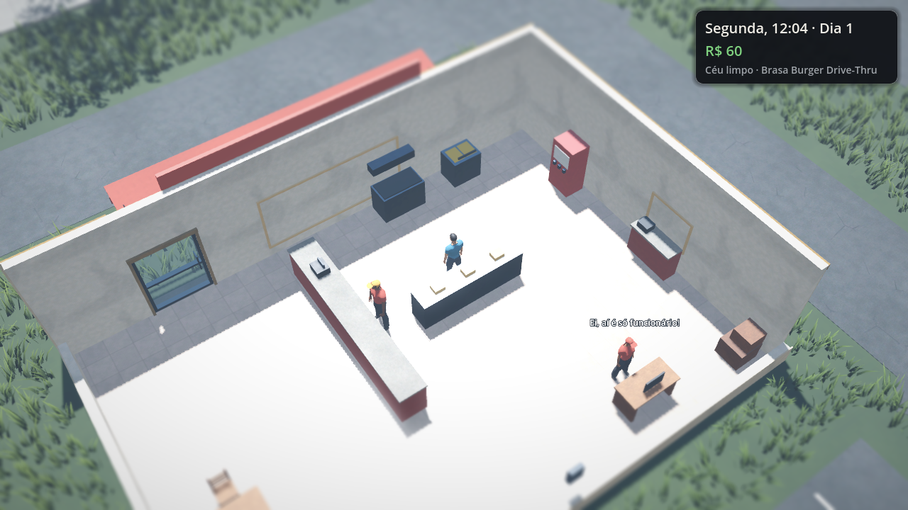
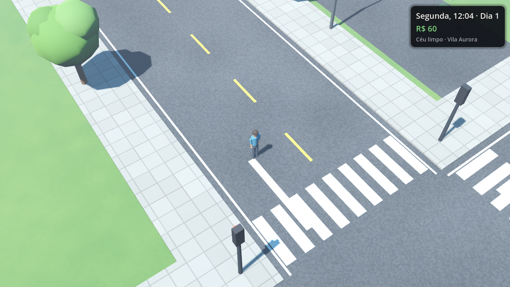
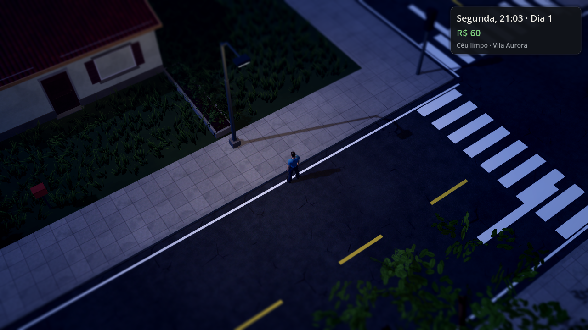
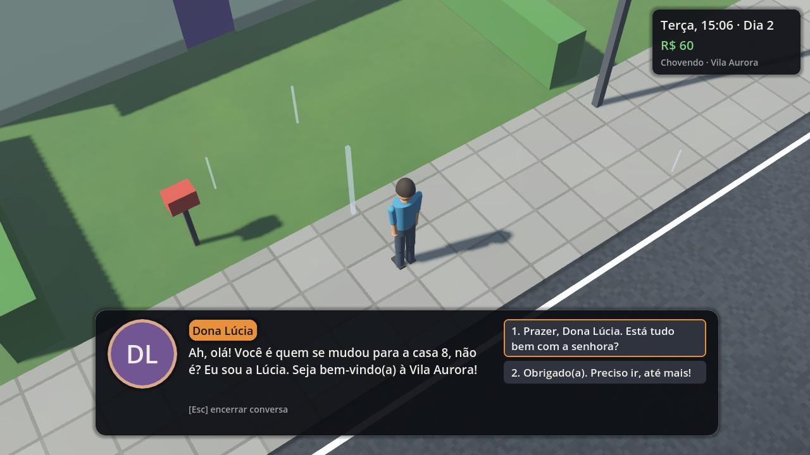

# Vila Aurora — Open World Life RPG (protótipo)

Um RPG de mundo aberto sobre **viver** numa cidade simulada: a profundidade sistêmica de
Project Zomboid, a liberdade urbana de GTA e a imersão de Red Dead Redemption 2 — sem zumbis,
com identidade, cidade e personagens originais.

Este repositório contém o **protótipo jogável** (Fases 0 e 1): um bairro pequeno, porém vivo,
onde é possível trabalhar num drive-thru ou como entregador, fazer compras, cuidar das necessidades
(inclusive frio, chuva e dor), dirigir, comprar casa, garagem e carro, consertar o próprio carro,
conversar, resolver uma missão de várias formas, reagir a eventos na rua e salvar o progresso.

- **Engine:** Godot 4.4 (GDScript) — abra `project.godot` e pressione F5.
- **Testes:** `GODOT=/caminho/do/godot tools/run_tests.sh`
  (283 verificações de unidade + testes de aceitação do protótipo e da Fase 1).

## Capturas (renderizador de compatibilidade/OpenGL)

| | |
|---|---|
|  |  |
|  |  |
|  |  |

## Documentação

- [`docs/DESIGN.md`](docs/DESIGN.md) — visão, escolha da engine, câmera e arte, arquitetura,
  plano de fases, riscos e critérios de conclusão.
- [`docs/PROTOTIPO.md`](docs/PROTOTIPO.md) — como rodar, controles, o que está implementado,
  como cada critério foi verificado e limitações conhecidas.
- [`docs/HISTORIA.md`](docs/HISTORIA.md) — estrutura da história principal (planejada).

## Estrutura

```
data/        conteúdo em JSON (itens, NPCs, diálogos, missões, lojas, emprego, veículos, mapa, traduções)
src/         código (autoload, systems, world, actors, vehicles, ui, audio, util)
tests/       testes de unidade, aceitação e capturas de tela
tools/       gerador do mapa e script de testes
docs/        documentação
```

Licença: MIT (ver `LICENSE`).
