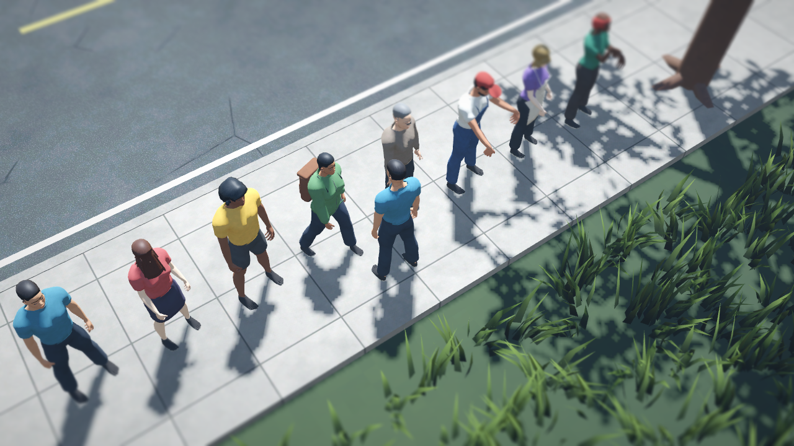
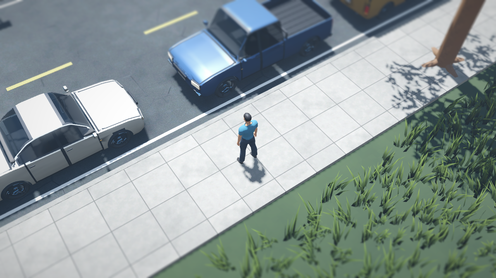
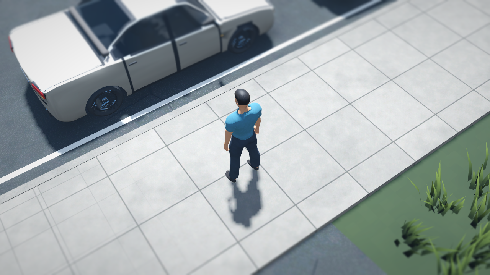
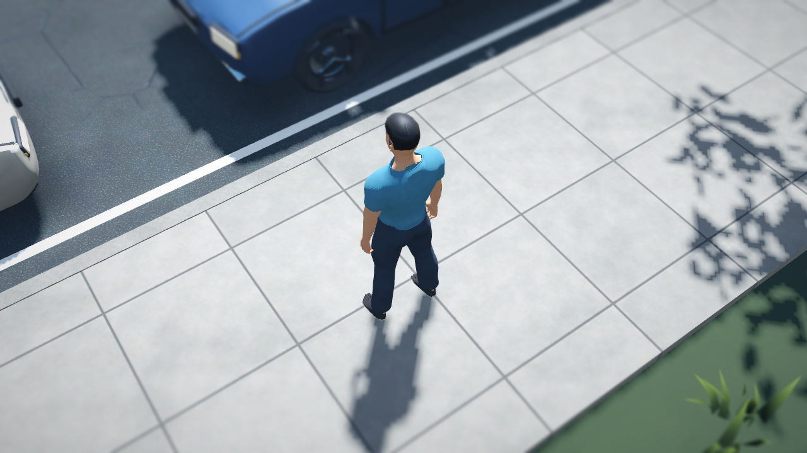
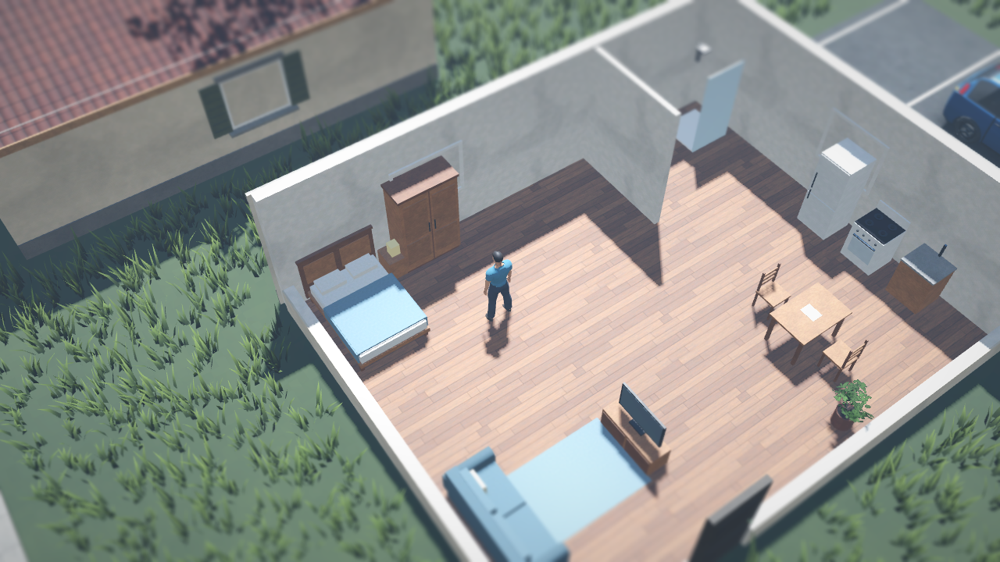
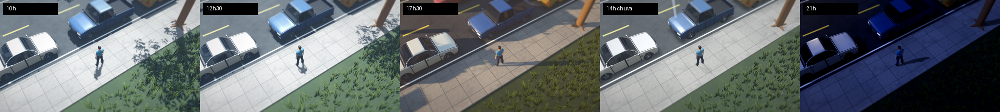
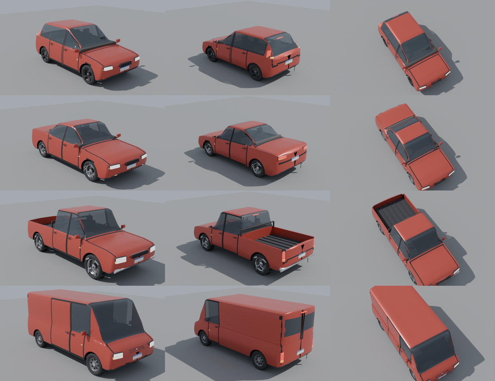

# Direção de arte

Duas passadas visuais até aqui:

1. **"Diorama vivo"**: grama densa, árvores de folhas, luz por hora e clima.
2. **Reformulação completa**, objeto deste documento. Personagens, veículos, prédios, ruas,
   interiores e materiais foram substituídos por modelos e texturas de verdade. As referências
   foram os princípios de Project Zomboid (leitura isométrica, roupas legíveis, densidade de
   detalhe, telhados e fachadas com textura) e a captura enviada (tijolo, lajes com equipamentos,
   canteiros, fiação, paleta contida). Nenhum ativo do PZ, GTA ou RDR foi usado.

| | |
|---|---|
|  |  |
|  |  |

*Manhã, meio-dia (luz branca, sem amarelado), fim de tarde (dourado), chuva e noite. Capturas
feitas no renderizador de compatibilidade (OpenGL 3) por software.*

---

## Etapa 1 — Auditoria do que existia

| Área | Antes | Problema |
|---|---|---|
| Personagens | Cápsulas, esferas e caixas (`Humanoid` de primitivas) | Sem anatomia, rosto, mãos ou roupas |
| Veículos | Caixas com rodas (`CarVisual`) | Sem silhueta automotiva; os quatro tipos eram a mesma caixa |
| Prédios | Caixas com cor de vértice; telhado de `PrismMesh` | Sem tijolo, reboco, telha, caixilho ou espessura |
| Ruas e calçadas | Shaders de grade e ruído | Sem meio-fio, vagas, mobiliário urbano ou fiação |
| Interiores | Caixas coloridas | Sem madeira, tecido ou metal |
| Materiais | Cores lisas, nenhuma textura | Tudo de plástico |
| Luz | Já variava com hora e clima (passada 1) | Mantida, com paleta mais contida |

**Motor: o projeto continua no Godot 4.4.** Não há limitação concreta que justifique migrar. O
Godot importa glTF com esqueleto, morphs e animações, gera LOD automático e tem PBR nos dois
renderizadores. Migrar para Unity ou Unreal exigiria reescrever cerca de 11,6 mil linhas de
GDScript em 59 arquivos (sistemas, interface, salvamento, IA e testes), sem ganho visual que o
Godot não entregue.

## Etapa 2 — Pesquisa de ativos (o que realmente aconteceu)

A rede deste ambiente só alcança GitHub e PyPI. Todas as bibliotecas abaixo responderam
**403 (bloqueado pela política de rede)**; nada foi baixado delas:

- Poly Haven (api.polyhaven.com, dl.polyhaven.org);
- ambientCG;
- Kenney (kenney.nl), Quaternius e Poly Pizza;
- Godot Asset Library (godotengine.org);
- Sketchfab, OpenGameArt, itch.io e CGTrader.

Para liberar, adicione os domínios em **Network access → Allowed domains** nas configurações do
ambiente.

Encontrado e avaliado pelo GitHub:

| Fonte | Licença (verificada) | Decisão |
|---|---|---|
| **MPFB2 / MakeHuman** (`makehumancommunity/mpfb2`): malha base, alvos de morph (sexo, idade, peso, etnia), esqueleto `game_engine` e pesos de pele | **CC0 1.0** para os ativos (`LICENSE.ASSETS.md`; o `license.txt` do MakeHuman diz que malha base, alvos, pesos e rigs são CC0, e o código é AGPL/GPL) | **Usado.** Só dados CC0; nenhum código AGPL/GPL entra no jogo |
| Bibliotecas de roupas e cabelos do MakeHuman (`makehuman-assets`) | — | Repositório inacessível daqui. Roupas e cabelos foram gerados por script (abaixo) |
| Kenney Starter Kits (Racing, City Builder, Platformer) | MIT | Baixados e avaliados. **Rejeitados:** estilo de brinquedo low-poly, contrário ao pedido |
| Blender 5.2 como módulo Python (`bpy`), numpy, Pillow (PyPI) | GPL/BSD | Ferramentas de geração (não vão no jogo) |

Créditos completos: [`assets/CREDITS.md`](../assets/CREDITS.md).

## Etapas 3 e 4 — O que foi feito e integrado

Tudo é reproduzível pelos scripts em `tools/art/` (ver
[`tools/art/README.md`](../tools/art/README.md)).

### Texturas PBR (`tools/art/make_textures.py` → `assets/textures/`)

- **Conjuntos:** 26 conjuntos tileáveis, cada um com cor, normal e ORM (oclusão, rugosidade,
  metálico) e escala física em metros (`textures.json`).
  - Tijolo com argamassa e tijolos queimados, reboco, concreto com poros, revestimento de madeira.
  - Asfalto com agregado, trincas e remendos; calçada de placas; **pedra portuguesa** em ondas.
  - Telha cerâmica com musgo; fibrocimento ondulado; laje com brita.
  - Tacos de madeira, porcelanato, azulejo, madeira de móvel, tecido, metal pintado, aço
    escovado e telha metálica ondulada.
  - Para personagens: malha de algodão, jeans (sarja), lona, couro, cabelo, borracha, terra e grama.
- **Síntese:** ruído espectral e Voronoi toroidais, perfeitamente repetíveis; normal calculada a
  partir da altura.
- **Shader de superfície** (`Mat.surface`/`Mat.named`):
  - projeção em caixa no espaço do mundo, sem UV na geometria procedural;
  - segunda amostra com escala e deslocamento diferentes para quebrar a repetição;
  - variação de tom em macro escala;
  - chuva escurece e deixa brilhante só o que está ao ar livre e virado para cima.
- **Importação:** compressão de VRAM e mipmaps (`tools/art/fix_imports.py`).

### Veículos (`tools/art/blender/make_cars.py` → `assets/vehicles/car_*.glb`)

Quatro modelos originais, sem marcas reais: **hatch, sedã, picape cabine dupla e van de carga**.

- **Carroceria:** loft de seções transversais suaves. Perfil lateral, linha de cintura, teto e
  estreitamento da estufa variam por tipo.
- **Caixas de roda:** recortadas por booleano.
- **Zonas da carroceria:** vidros, colunas, borrachas, plásticos de para-choque e saia, frisos das
  portas, do capô e do porta-malas.
- **Peças projetadas na carroceria (raycast):** faróis com moldura e seta, lanternas, grade com
  frisos cromados e emblema, entrada de ar, placas no padrão branco com faixa azul (sem texto),
  faróis de neblina, brake-light e escapamento.
- **Rodas:** pneu com banda de rodagem e ombro; aros de 5 raios duplos, 6 raios, 6 raios
  robustos ou de aço com calota; disco e pinça de freio; porcas.
- **Outros detalhes:** retrovisores com espelho, maçanetas, limpadores, interior (painel,
  volante, bancos), caçamba com assoalho frisado e santo-antônio.
- **Luz e vidro:** oclusão ambiente assada nas cores de vértice (Cycles); vidro escurecido
  semitransparente.

`CarVisual` mantém a mesma interface: `build`, `animate` (rodas giram e esterçam), `set_lights`,
`set_door` (a porta do motorista abre na dobradiça) e a fumaça de motor avariado. A pintura é
recolorida por instância, e há uma sombra de contato sob o carro.

### Personagens (`tools/art/blender/make_characters.py` → `assets/characters/human_m.glb` e `human_f.glb`)

- **Corpo e esqueleto:** corpo do MakeHuman com morphs CC0 e esqueleto de 53 ossos com os pesos
  oficiais.
- **Shape keys (por personagem):** `heavy`, `thin`, `old`, `face_a`, `face_b`.
- **Roupas:** cortadas das malhas de ajuda CC0 (meia-calça e saia), com pesos e morphs herdados.
  - Bordas suavizadas, barra/gola/cós como geometria (costuras) e espessura real.
  - Camiseta, manga longa, jaqueta com zíper, calça reta, bermuda, saia, macacão com alças e
    botões, avental, mochila, boné com aba e gorro.
  - Sapatos com sola de borracha.
- **Cabelos e pelos:** curto, penteado, bagunçado, cacheado, comprido, chanel, coque, rabo de
  cavalo e careca, além de barba e bigode. Mechas afinam até o couro cabeludo e não cobrem as
  orelhas.
- **Rosto:** olhos com íris e pupila, cílios, sobrancelhas e lábios pintados na textura da pele
  (com poros, rubor e sombras).
- **Pele sob a roupa:** escondida por região no shader, sem atravessar o tecido.
- **Animações** (esqueleto, 30 fps): `idle` (respiração e troca de apoio), `walk`, `run`, `talk`,
  `work`, `eat`, `search`, `sit`, `lie`, `knocked`. Caminhada e corrida têm fases de apoio e
  balanço, flexão de joelho, rolamento do pé, balanço de quadril e braços. A velocidade da
  animação acompanha a velocidade real; idosos andam mais devagar e curvados.

`Humanoid` mantém a mesma interface (`build(appearance)`, `set_pose`, `speed`, `lod_far`,
`pose`). Ele lê as chaves de aparência existentes e algumas novas e opcionais:

- existentes: pele, cabelo e estilo, camisa, calça, altura, porte, idoso, barba, bigode, boné,
  gorro, mochila, avental, macacão e jaqueta;
- novas: `sex`, `top` (`long`) e `bottom` (`shorts`/`skirt`).

A criação de personagem ganhou a escolha de corpo.

### Prédios, ruas e mobiliário (`src/world/WorldBuilder.gd`)

- **Paredes:** duas camadas, reboco por dentro e fachada por fora. A fachada é tijolo, reboco,
  concreto ou madeira conforme o tipo, ou `style.facade`. Têm rodapé de concreto, cimalha,
  batentes e soleira.
- **Janelas:** caixilho com travessas, peitoril saliente e verga. Casas têm venezianas de ripas;
  lojas têm toldo de lona com mãos-francesas.
- **Casas:** telhado cerâmico de duas águas com beiral e forro, testeiras, cumeeira, empenas e
  chaminé de tijolo.
- **Lojas e prédios:** laje com platibanda, condensadoras com hélice, exaustores, alçapão, caixa
  d'água e tubulações, como na referência.
- **Portas:**
  - de madeira com almofadas e maçanetas nos dois lados;
  - de vidro com caixilho de alumínio e puxador;
  - de enrolar ondulada.
- **Ruas:** asfalto texturizado, meio-fio de concreto, vagas pintadas nos estacionamentos,
  bueiros, hidrantes e **postes de energia com fiação** ao longo das ruas. Ficam longe de
  esquinas, portas e entradas de garagem.
- **Praça e verde:** praça em pedra portuguesa; canteiros de concreto com arbustos; árvores com
  raízes, galhos e copa densa, que ficam ralas quando estão entre a câmera e o personagem (como
  no PZ).
- **Mobília:**
  - cama com pés, cabeceira almofadada, travesseiros e colcha caindo nas laterais;
  - sofá com almofadas separadas;
  - guarda-roupa com portas almofadadas e puxadores;
  - geladeira de duas portas;
  - fogão com bocas, botões e vidro do forno;
  - cadeiras de ripas, mesa com saia, rack com TV e plantas de folhas;
  - tudo com madeira, tecido, metal ou pedra.
- **Objetos:** bancos de ripas com pés de ferro fundido, poste de luz com braço, lixeira,
  abrigo de ônibus de vidro, bomba de combustível, chafariz com água e semáforos com pala.
  Itens no chão viram sacolas de papel com faixa da categoria.

## Etapa 5 — Desempenho

- **LOD automático** na importação de carros e personagens. A nova opção **Detalhe dos modelos**
  (baixo, médio, alto) muda o limiar de LOD.
- **Materiais compartilhados:**
  - mobília, paredes e mobiliário urbano são agrupados por bloco de 40 m, com uma superfície por
    material;
  - o cenário usa um único shader de superfície com cache por material;
  - pintura de carro e roupa são cacheadas por cor.
- **Texturas:**
  - comprimidas em VRAM (S3TC/BPTC) com mipmaps;
  - 512 px na maioria e 1024 px em asfalto, pedra portuguesa e telha;
  - mapa de regiões da pele sem perdas.
- **NPCs distantes** param de animar (`lod_far`), como antes.
- **Opções que continuam valendo:** sombras, escala de renderização, grama, tilt-shift e
  gradação.
- **Tamanhos:** carros com ~40 mil triângulos (rodas inclusas). O corpo do personagem tem
  ~27 mil e, com roupa e cabelo, fica em ~35 a 45 mil (o arquivo tem 112 mil com todas as
  peças, a maioria oculta). O LOD reduz isso à distância.

## Etapa 6 — Regressão

Todos os sistemas foram preservados: controles, câmera, interação, inventário, necessidades,
habilidades, veículos, NPCs, empregos, economia, imóveis, missões, diálogos, salvamento, menus
e opções. Colisões e escalas foram mantidas (as colisões continuam vindo dos dados, não dos
modelos). Resultado dos testes: **283 verificações de unidade, 75 de aceitação do protótipo e
60 da Fase 1, todas passando.**

A regressão revelou um defeito antigo do trânsito: carros que entravam juntos no cruzamento
podiam se travar para sempre. Ele passou a aparecer mais porque a sequência aleatória mudou com
as animações. O defeito foi corrigido em `TrafficCar.gd`: um carro parado há algum tempo dentro
ou na boca do cruzamento deixa de esperar pelos outros carros, mas continua respeitando pedestres
e o jogador. Depois da correção, o teste de aceitação passou em 10 de 10 execuções seguidas.

## Limitações (honestas)

- **Validação visual.** Foi feita só no renderizador de compatibilidade com rasterização por
  software. O Forward+ (clearcoat da pintura, reflexos e sombras melhores) não foi visto aqui, e
  o desempenho não foi medido em GPU real.
- **Texturas.** São procedurais, não fotoescaneadas. São consistentes e repetíveis, mas menos
  ricas que um escaneamento (Poly Haven/ambientCG continuam bloqueados neste ambiente).
- **Personagens:**
  - roupas justas ao corpo, sem simulação de tecido;
  - cabelos em cascas sólidas (sem mechas transparentes);
  - sapatos derivados do pé;
  - sem animação facial nem dedos animados individualmente.
- **Carros:** sem deformação de batida; interior simples; portas, exceto a do motorista, são
  frisos.
- **Prédios:** ainda são retângulos gerados por dados. Não há segundo andar acessível,
  decalques de sujeira nem grafite.
- **Animações:** são procedurais (chaves geradas por código), não captura de movimento.
  Faltam transições específicas (sentar e levantar, deitar).

## Regras de consistência

1. Dourado é um momento do dia, não uma cor do jogo.
2. A leitura vem primeiro: personagens, portas e itens interativos se destacam do cenário.
3. Todo efeito tem nível nas opções e custo medido; nada que não possa ser desligado.
4. Arte nova entra substituindo um visual com a mesma interface, sem mudar sistemas.
5. Ativo de terceiros só entra com licença verificada e crédito em `assets/CREDITS.md`.
